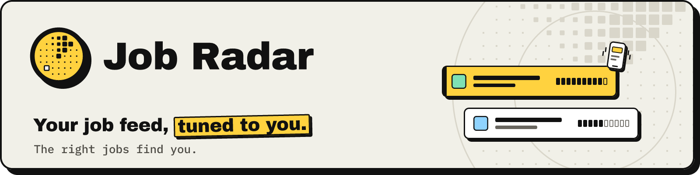

<p align="center">
  <picture>
    <source media="(prefers-color-scheme: dark)" srcset="docs/images/brand/readme-header-dark.png">
    
  </picture>
</p>

<h3 align="center">Tell it what you want. It reads every job, scores it for you, and sends the good ones to your phone.</h3>

<p align="center">
  <a href="LICENSE"></a>
  <a href="https://github.com/Joevonlong/job-radar/releases"></a>
  <a href="https://github.com/Joevonlong/job-radar/actions/workflows/ci.yml"></a>
  
  
</p>

<p align="center">
  <a href="https://joevonlong.github.io/job-radar-site/"><b>Website</b></a> ·
  <a href="docs/README.md"><b>Docs</b></a> ·
  <a href="#quick-start"><b>Quick start</b></a> ·
  <a href="docs/faq.md"><b>FAQ</b></a> ·
  <a href="README.zh.md"><b>中文</b></a>
</p>

<p align="center">
  
</p>

<table>
  <tr>
    <td width="50%"><p align="center"><b>Every source, one feed</b></p></td>
    <td width="50%"><p align="center"><b>Your rules, not ours</b></p></td>
  </tr>
  <tr>
    <td width="50%"><p align="center"><b>It reads every job for you</b></p></td>
    <td width="50%"><p align="center"><b>The good ones come to you</b></p></td>
  </tr>
</table>

## What it does

- **Collects** new postings from the job boards, company career pages and job-alert emails you pick, and merges duplicates.
- **Filters** by your cities, salary floor, contract types and dealbreakers, written in your own words.
- **Scores** every job 0–100 with your own AI (a `claude` / `codex` subscription or an API key), with reasons, gaps and the salary quoted from the ad.
- **Pushes** the good ones to your own Telegram bot, with buttons that move them on your application board.
- **Stays yours:** self-hosted, open source, no accounts, no telemetry. It does not apply for you.

More: [features and screenshots](docs/features.md).

## Quick start

You need Docker with Compose 2.24 or newer, Node 22 with pnpm 11 and git, on macOS or Linux (Windows: inside WSL2, see
[platform notes](docs/installation.md#macos-linux-windows)).

```bash
git clone https://github.com/Joevonlong/job-radar.git
cd job-radar
git checkout v2.0.1                  # the latest release; main is the development branch
cp .env.example .env                 # every value has a working default; secrets go here later
```

On Linux, let the containers run as your user before the first start (macOS skips this):

```bash
sed -i.bak -e "s/^PUID=.*/PUID=$(id -u)/" -e "s/^PGID=.*/PGID=$(id -g)/" .env && rm .env.bak
mkdir -p data/config data/profile data/backups data/exports data/logs .auth
```

Start the stack, then the AI worker on your machine (leave it running):

```bash
docker compose up -d --build         # db, web, runner, jobspy; the first build takes a few minutes
pnpm install
pnpm ai-worker                       # or scripts/ops/install-ai-worker.sh to run it as a background service
```

Open <http://127.0.0.1:3000>. The setup wizard asks eight short questions; nothing is collected until you finish it.
No browser on this machine? Run the same wizard in the terminal:

```bash
pnpm run setup                       # all eight steps
pnpm run setup --step telegram       # Telegram pushes, any time later
pnpm run doctor                      # checks everything and says what to fix
```

Sign in to your AI first (`claude` then `/login`, or `codex login`). The full walkthrough, with updating, backups,
phone access and troubleshooting: **[docs/installation.md](docs/installation.md)**.

## Documentation

- [Features and screenshots](docs/features.md): what it does, how it works
- [Installation](docs/installation.md) and [first-run setup](docs/setup.md)
- [Configuration](docs/configuration.md): where your settings live
- [AI options](docs/ai-providers.md): subscription CLI or API key, and what it costs
- [Privacy](docs/privacy.md): what is stored and what leaves your machine
- [FAQ](docs/faq.md) · [Roadmap](docs/roadmap.md) · [All guides](docs/README.md)

## Contributing

Issues and pull requests are welcome: see [CONTRIBUTING.md](CONTRIBUTING.md) and [docs/development.md](docs/development.md).
Every commit needs a DCO sign-off (`git commit -s`). Questions go to
[Discussions](https://github.com/Joevonlong/job-radar/discussions); the [Code of Conduct](CODE_OF_CONDUCT.md) applies.

## Security

Report vulnerabilities privately as described in [SECURITY.md](SECURITY.md). The dashboard listens on `127.0.0.1`
only; before anyone else can reach it, set a password with `pnpm web:password`
([web access](docs/configuration.md#web-access-optional-password-bind-address-and-port)).

## Scraping and terms of service

Sources that scrape a site are off in a new install and ask for your confirmation; you are responsible for respecting
each site's terms. Not affiliated with any job board; trademarks belong to their owners. Details and disclaimer:
[docs/sources.md](docs/sources.md#scraping), [NOTICE](NOTICE).

## License

[AGPL-3.0-only](LICENSE). Running a modified version as a service for others means offering them your source; for
companies and teams see [docs/commercial-use.md](docs/commercial-use.md). Built on Next.js, PostgreSQL, Drizzle ORM and
python-jobspy.
