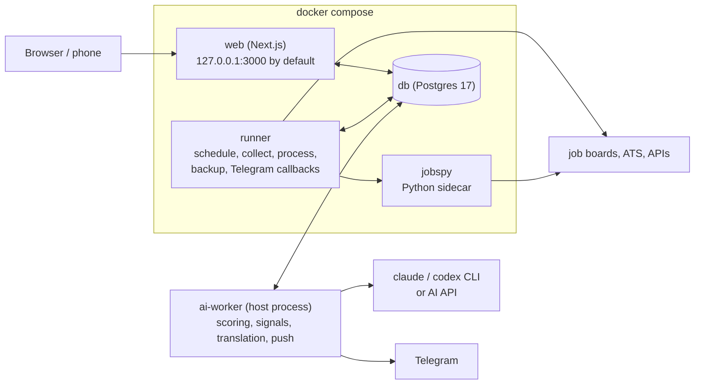

<p align="center">
  <picture>
    <source media="(prefers-color-scheme: dark)" srcset="docs/images/brand/readme-header-dark.png">
    
  </picture>
</p>

<h3 align="center">Tell it what you want. It reads every job, scores it for you, and sends the good ones to your phone.</h3>

<p align="center">
  <a href="LICENSE"></a>
  <a href="https://github.com/Joevonlong/job-radar/releases"></a>
  <a href="https://github.com/Joevonlong/job-radar/actions/workflows/ci.yml"></a>
  
  
</p>

<p align="center">
  <a href="https://joevonlong.github.io/job-radar-site/"><b>Website</b></a> ·
  <a href="docs/README.md"><b>Docs</b></a> ·
  <a href="#quick-start"><b>Quick start</b></a> ·
  <a href="docs/faq.md"><b>FAQ</b></a> ·
  <a href="README.zh.md"><b>中文</b></a>
</p>

<p align="center">
  
</p>

## What it is

Job Radar is a job feed you run on your own computer.

You tell it what you're after: the roles, the cities, the pay you won't go below, the things you'd never accept. On the
schedule you pick, it pulls new postings from the job boards and company career pages you choose, merges the
duplicates, clears out the noise, and has your AI read every job that's left. Each job gets a 0–100 match score with the
reasons it fits and the gaps. The ones that clear your bar land in Telegram, with buttons to act on them. Everything
else waits on a dashboard in your browser.

**Job Radar does not auto-apply.** It finds, reads, scores and keeps track. You decide, and you apply.

It's self-hosted and open source. Your database is stored on your machine, it uses the AI subscription you already pay for (or
an API key), and there are no accounts and no telemetry.

## Why Job Radar

### 1. Every source, one feed

Pick the job boards and company career pages you care about. They all land in one list. The same job posted on five
sites shows up once, with every link kept. Agency posts and closed ads are flagged. Text hidden in an ad to steer AI
readers is stripped before your AI sees it.

- LinkedIn, Indeed, StepStone, XING, Arbeitsagentur, Google Jobs
- Career pages on Greenhouse, Lever, Ashby, Personio and SmartRecruiters
- Your own job-alert emails from Gmail

Sources that scrape a site (LinkedIn guest search, Indeed, StepStone, XING, Google Jobs via the sidecar) start switched off. The setup wizard shows
the terms-of-service risk and asks you to confirm before you turn one on.

<p align="center"></p>

### 2. Your rules, not ours

This is the part that makes it yours. Set the pay you won't go below, your cities, contract types and companies to
skip. Then say what matters in plain words, in any language: what you want most, what's a nice extra, and what you
will never accept. A job that hits a dealbreaker drops into the 0–29 band and sinks to the bottom.

- Salary floor, cities, contract types, blocked companies
- Scoring criteria in your own words
- Your own signal categories (equity, bonus, benefits, anything) and saved views

<p align="center"></p>

### 3. It reads every job, so you don't have to

Every job that passes your filters gets a 0–100 match score with reasons and gaps. Pay buried in the text is found,
quoted, turned into a yearly figure you can compare, and set against what similar jobs you collected pay. Long ads can
be broken down into tasks, stack and must-haves, matched against your skills, and translated into your language.

- Match score with reasons and gaps
- Salary found, quoted, made yearly, compared with similar jobs
- Job breakdown, skill match, translation

<p align="center"></p>

### 4. The good ones come to you

Connect your own Telegram bot, and after every cycle the jobs over your bar arrive with their score, pay and badges.
Tap **👍 Interested** or **🚫 Ignore** right there (and **📄 Tailor résumé** if you use resume-kit), and your application
board follows. A reminder nudges you when an application goes quiet.

- Push with buttons, quiet hours
- Application board and reminders
- Alerts when a source breaks

<p align="center"></p>

**Underneath:** self-hosted · open source (AGPL-3.0) · your database is stored on your machine · your AI subscription or API
key · no accounts · no telemetry.

## Screenshots

<table>
  <tr>
    <td width="50%"><p align="center"><b>Today</b></p></td>
    <td width="50%"><p align="center"><b>Job breakdown & skill match</b></p></td>
  </tr>
  <tr>
    <td width="50%"><p align="center"><b>Clean input for your AI</b></p></td>
    <td width="50%"><p align="center"><b>Filters and saved views</b></p></td>
  </tr>
  <tr>
    <td width="50%"><p align="center"><b>Track applications</b></p></td>
    <td width="50%"><p align="center"><b>Keyboard flow</b></p></td>
  </tr>
  <tr>
    <td width="50%"><p align="center"><b>Many sources</b></p></td>
    <td width="50%"><p align="center"><b>Your AI, your subscription</b></p></td>
  </tr>
</table>

### Static screenshots

<p align="center"></p>

<table>
  <tr>
    <td width="50%"><picture><source media="(prefers-color-scheme: dark)" srcset="docs/images/today-dark.png"></picture><p align="center"><b>Today</b></p></td>
    <td width="50%"><picture><source media="(prefers-color-scheme: dark)" srcset="docs/images/job-detail-dark.png"></picture><p align="center"><b>A job: score, quoted salary, AI trap</b></p></td>
  </tr>
  <tr>
    <td width="50%"><p align="center"><b>Application board</b></p></td>
    <td width="50%"><p align="center"><b>Settings</b></p></td>
  </tr>
  <tr>
    <td width="50%"><p align="center"><b>Telegram message (format preview)</b></p></td>
    <td width="50%"><p align="center"></p><p align="center"><b>On a phone</b></p></td>
  </tr>
</table>

Demo data throughout: the companies and jobs are invented. To click around the same sample data yourself, see
[Try it with sample data](docs/development.md#try-it-with-sample-data).

## Features

**One place**

| | |
|---|---|
| Many sources | LinkedIn (guest search; optional: your own logged-in session (experimental, not yet tested against a real login), or paid Bright Data / Apify), Indeed, StepStone, XING, Arbeitsagentur, Google Jobs via JSearch, company career pages on Greenhouse, Lever, Ashby, Personio and SmartRecruiters, job-alert emails from Gmail. [All sources](docs/sources.md) |
| Your consent first | Sources that scrape a site or use your own LinkedIn login are off in a new install. Turning one on shows the risk and asks you to confirm. [Scraping](docs/sources.md#scraping) |
| Isolated | One source failing never stops a cycle. Each has a circuit breaker and an optional monthly budget. |
| One job, not five | Near-duplicates across sources merge into one entry, with every source link kept. |
| Noise flagged | Agency posts are marked. A job that stops showing up is marked "possibly closed"; a dead link marks it "closed". |
| Closed jobs | Mark a job closed yourself (undo any time); closed and possibly-closed jobs move to their own Closed view. Saved and in-pipeline jobs get a polite recheck of their source link (robots.txt honoured). |
| Clean input for your AI | Some ads hide text meant to steer AI readers (white-on-white text, invisible characters, "if you are an AI…"). Job Radar strips it before any AI reads the ad and shows you what it found. [How](docs/ai-traps.md) |

**Tuned to you**

| | |
|---|---|
| Hard filters | Cities, salary floor, contract types, blocked companies. Filtered jobs aren't deleted; you can see them and why. |
| Scoring criteria | Your priorities, nice-to-haves and dealbreakers, one sentence each, any language. A dealbreaker puts a job into the 0–29 band. |
| Signal categories | Up to 12 of your own (an amount, keywords or a tag), each with a weight and colour. Start from a blank category or a ready-made preset such as "AI tools / token budget" or "Open-source time". Badges show up in lists and pushes. [Signals](docs/signals.md) |
| Filters and saved views | Score, signal, source, city, remote, language requirement, salary, status, date. Save a combination and switch to it on Today. |
| Sort and catch up | Click a column header on Jobs to sort by score, salary or freshness. Jobs you haven't opened yet are bold with a dot; show "Unseen only", "Mark all as seen", and a divider marks what's new since your last visit. |
| Market packs | A neutral default plus a Germany / EU pack (local job boards, German-level rules, EUR). For another country, copy a pack. [Market packs](docs/market-packs.md) |
| Watched companies | New jobs from companies you watch skip the push threshold, even before they have a score. |

**AI reads for you**

| | |
|---|---|
| Match score | 0–100, with the reasons it fits and the gaps, based on your profile, your preferences and your criteria. |
| Salary, surfaced | Rules find it, the AI confirms it, every amount is quoted from the ad. Monthly, hourly, "up to 120k" and foreign currencies become a yearly figure in your currency, original kept, shown on an axis against your floor. |
| Salary level | Where a job's stated pay stands among comparable postings you collected (same kind of role, seniority and place), with the sample size shown, plus links to salary sites. No AI involved. [Salary](docs/salary.md) |
| Salary lookup | Optional, off by default (`lookup.enabled: true` in `salary.yaml`), one click per job: the AI searches public salary pages for the company's pay level and the band of this role, and shows its sources. It only sends company, title, city, country and seniority. [Salary](docs/salary.md#salary-lookup-ai-with-web-search) |
| Ranking | Rank value = match score + a capped bonus for signals like a stated salary or equity. |
| Facts from the ad | Remote / hybrid / on-site, contract type, local-language requirement (such as German B2). |
| Job breakdown | Optional, off until you switch it on. Tasks, stack, experience, soft skills and languages, each marked required or nice-to-have with a quote from the ad. Your skills are matched locally; your profile isn't sent for this. [Breakdown](docs/breakdown.md) |
| Translation | Long ads in your language, original one tap away. High scorers are translated automatically. |
| Weekly suggestions | From the jobs you marked, the AI suggests new signal words, companies to watch and filters, each with evidence. Nothing changes until you approve. |
| Insights | New jobs per day, sources, cities, how often pay is disclosed, signals, filter reasons. |

**On your phone**

| | |
|---|---|
| Push after every cycle | Off until you connect your own Telegram bot. Then a summary, then one card per qualifying job: rank value, badges, title, company, city. At most 10 per cycle by default. [Telegram](docs/telegram.md) |
| Buttons | 👍 Interested · 🚫 Ignore · ⭐ Save, plus 📄 Tailor résumé when resume-kit is set up. The board updates as you tap. |
| Quiet hours and reminders | Pushes wait out the night. A daily reminder lists jobs you liked but haven't applied to, and applications with no reply. |
| Health alerts | A source's circuit breaker opened, a login expired, a budget hit 80 %, every AI provider failed. |
| No open port | Telegram button taps are fetched by long polling. Nothing on your machine faces the internet. |
| Application board | Drag cards from New to Offer; every move is on a timeline and can be undone. Favorites are kept separately, even for closed jobs. |
| Résumé hand-off | Exports the ad and gives you the command for resume-kit, a separate résumé tailoring tool. [resume-kit](docs/resume-kit.md) |

**Run it yourself**

| | |
|---|---|
| Setup wizard | Eight short steps in the browser (or in the terminal): language, market, profile, targets, sources, AI, Telegram, a first cycle. |
| Your AI | Your `claude` or `codex` subscription login (nothing billed per token), an API key with a monthly budget, or both. |
| Ops built in | Daily backups of the database, your config and your profile, with retention; a safety backup before every database migration; restore tooling; `pnpm run doctor` health check; a deploy script that upgrades to a release tag. |
| Optional password | No login needed on your own machine. Before anyone else can reach the dashboard, set a password with `pnpm web:password`. [Web access](docs/configuration.md#web-access-optional-password-bind-address-and-port) |
| Light, dark, phone | Paper-light and terminal-dark themes, English and Chinese interface, a full phone layout, keyboard shortcuts (`⌘K`, `j` / `k`, `s`, `x`, `f`). |
| Works with your AI tools | Plain YAML config with comments, command-line tools (`pnpm run doctor`, `pnpm sources:list`, `pnpm config:check`), and job ads exported as Markdown for other tools. |

## How it works



1. **Collect.** On your schedule, the runner fetches new postings from the sources you switched on and stores each one as it arrived.
2. **Clean.** Pay, remote mode, languages and contract type are read out, duplicates merge, your hard filters apply.
3. **Score.** The ai-worker on your computer hands each job to your AI: `claude` or `codex` with your own login, or an API key.
4. **Push.** Jobs over your bar go to Telegram, if you set it up. Everything is on the dashboard.

| Part | Where it runs | What it does |
|---|---|---|
| `web` | container, `127.0.0.1:3000` by default (`JOB_RADAR_WEB_BIND`, `JOB_RADAR_WEB_PORT`) | The dashboard. Settings pages write your config files; buttons queue requests. |
| `runner` | container | Runs the cycles (collect, process, filter, signals, maintenance), the daily backup and Telegram button taps. |
| `jobspy` | container, internal network only | Scraping sidecar for LinkedIn guest search, Indeed and Google Jobs. |
| `db` | container | All data, in the Docker volume `jobradar-pg` (by default). |
| `ai-worker` | **your machine (host)** | Picks up every AI request, runs it with your CLI login or API key, writes the result back, sends the Telegram push. |

The containers hold no AI credentials. No AI connected yet? Job Radar still collects, de-duplicates, filters and shows
postings; only scoring, translation, breakdowns, the AI signal check and the push wait for one.

## Quick start

You need Docker with Compose 2.24 or newer, Node 22 with pnpm 11, and git, on macOS or Linux (on Windows, inside WSL2: see
[Platform notes](#platform-notes)).

```bash
git clone https://github.com/Joevonlong/job-radar.git
cd job-radar
git checkout v2.0.1              # the latest release; main is the development branch
```

**On Linux, do this before the first `docker compose up`.** The containers must run as your user. If your uid isn't 1000
and you skip this, `docker compose up` still reports healthy, but the web can't save your settings and backups fail:

```bash
[ -f .env ] || cp .env.example .env
sed -i.bak -e "s/^PUID=.*/PUID=$(id -u)/" -e "s/^PGID=.*/PGID=$(id -g)/" .env && rm .env.bak
mkdir -p data/config data/profile data/backups data/exports data/logs .auth
```

More in [docs/installation.md, step 3](docs/installation.md#3-start-the-stack) and [docs/host-setup.md](docs/host-setup.md).
Then start the stack:

```bash
docker compose up -d --build     # db, web, runner, jobspy; the first build takes a few minutes
```

Start the AI worker on your machine and leave it running:

```bash
pnpm install
pnpm ai-worker                   # or scripts/ops/install-ai-worker.sh: a background service (launchd on macOS, systemd on Linux)
```

Open <http://127.0.0.1:3000>. The setup wizard starts by itself and asks eight short questions. Nothing is collected
until you finish it (or skip it). Then check everything:

```bash
pnpm run doctor                  # every check ✅ / ⚠️ / ❌, with what to do
```

Sign in to your AI first if you haven't: `claude` then `/login`, or `codex login`. Keys and tokens go in `.env` only;
the wizard never asks for them. Telegram stays off until you create your own bot; then `pnpm run setup --step telegram`
connects it. The full walkthrough, with Telegram,
phone access and updates, is in **[docs/installation.md](docs/installation.md)**.

## Installation

[docs/installation.md](docs/installation.md) covers requirements, every step on macOS and Linux, running the AI worker
in the background, Telegram, phone access over Tailscale, updating to a release, backups, uninstalling and the most
common problems. Unattended on a Mac (Docker at login, restart after power loss)? See
[docs/host-setup.md](docs/host-setup.md). Every guide, in English and Chinese, is listed in [docs/](docs/README.md).

## Platform notes

- **macOS and Linux** run everything (the tested platforms). `scripts/ops/install-ai-worker.sh` keeps the AI worker
  alive: a launchd agent on macOS, a systemd user unit (`job-radar-ai-worker.service`) on Linux. Without either, run
  `pnpm ai-worker` under a supervisor of your own.
- **Linux:** set `PUID` / `PGID` in `.env` to your user before the first `docker compose up` (see
  [Quick start](#quick-start)). The host checklist for Linux is section 10 of [docs/host-setup.md](docs/host-setup.md#10-linux).
- **Windows (WSL2):** run everything inside WSL2. Clone the repository into the Linux file system (for example
  `~/job-radar`, not under `/mnt/c`, where bind mounts are slow and permissions differ), turn on Docker Desktop's WSL
  integration for that distribution, and install Node, pnpm and the `claude` / `codex` CLIs inside WSL. `pnpm ai-worker`
  runs in WSL too (under tmux, or as a systemd user service where WSL has systemd). Open <http://127.0.0.1:3000> in the
  Windows browser. WSL2 is not tested by the maintainer; reports are welcome.
- **One person, one instance.** A second installation on the same machine needs its own project name, volume and ports:
  [docs/multiple-instances.md](docs/multiple-instances.md).

## Configuration

Everything you set lives in plain YAML files with comments, and almost all of it can be changed on the Settings page.

| Layer | Folder | In git? | Written by |
|---|---|---|---|
| Shipped defaults | `config/` | yes, read-only | the project (updates replace them) |
| Your config | `data/config/` | no | the Settings pages, or you |
| Your profile | `data/profile/` | no | the profile page (`/me`), or you |

A file in `data/config/` wins over the default with the same name, so `git pull` never touches your settings.
`pnpm config:check` validates everything. Want a head start? `pnpm config:example` applies a ready-made setup.
Details: [docs/configuration.md](docs/configuration.md).

Secrets (API keys, the Telegram token, the Gmail app password, the web password hash) go only in `.env`, never in the
YAML files. The one exception to watch: `jobspy.proxies` in `sources.yaml` can contain proxy credentials (`user:password@host`), and the config archive of every backup includes that file, so keep backup archives private. A source without its key shows "not configured" and sends nothing. Which source needs which key:
[docs/installation.md](docs/installation.md#2-optional-create-env).

## AI options

| | How | Cost |
|---|---|---|
| **Subscription CLI** (default) | The ai-worker runs `codex` and `claude` with the logins you already have (`codex login`; `claude`, then `/login`). | Nothing per token. Daily caps (codex 200, claude 100 calls) protect your plan's quota. |
| **API key** (optional) | Put `ANTHROPIC_API_KEY`, `DEEPSEEK_API_KEY` or `MIMO_API_KEY` in `.env`. DeepSeek and MiMo also need switching on in `ai.yaml`. | Pay per token, stopped by `monthly_api_budget_usd` in `ai.yaml`. |

Use either or both. API providers are only tried after the CLIs. If a provider is unavailable the next one takes over, so every provider you leave switched on can receive the text; switch a provider off to keep text from that vendor ([which providers receive job text](docs/ai-providers.md#which-providers-receive-job-text)). `pnpm ai:probe` shows which providers work right now.
Consumer subscriptions are personal licences: read [docs/commercial-use.md](docs/commercial-use.md) before using them for
anyone but yourself. More: [docs/ai-providers.md](docs/ai-providers.md), usage and cost:
[docs/ai-usage.md](docs/ai-usage.md).

## Privacy and data

Your jobs, profile and applications live in a Postgres database in Docker on your machine. There are no accounts, no
telemetry and no hosted service. Here is what does leave your machine:

| What | Goes to |
|---|---|
| The job text, plus your profile summary, skills, languages, job preferences (target roles, cities, work modes, seniority, salary floor, excluded companies and keywords, contract types) and your scoring criteria | The AI you configured, for scoring |
| The job text only | The AI, for translation and breakdowns |
| Company, job title, city, country and seniority, only when you click "Look up salary" | The AI, which searches public salary pages |
| The jobs you marked and their application status | The AI, for the weekly suggestions (switch off with `suggest.enabled` in `schedule.yaml`) |
| Push messages | Your own Telegram bot, if you set one up (stored on Telegram's servers) |
| Requests for listings, and checks that a posting is still online | The sources you switched on (keyed search APIs also see your search terms) |

If a provider is unavailable the next one takes over, so every provider you leave switched on can receive the text; switch a provider off to keep text from that vendor ([which providers receive job text](docs/ai-providers.md#which-providers-receive-job-text)).

Using a subscription CLI means your provider's consumer terms apply: check its data and training settings. If you run
the résumé hand-off command yourself, it sends your full résumé and the ad to Claude. What is stored, for how long, each
provider's data policy and how to delete everything: [docs/privacy.md](docs/privacy.md).

## FAQ

**Does it apply to jobs for me?** No. It finds, reads, scores and keeps track; you decide and you apply.

**Is it free?** Yes, AGPL-3.0, and you run it. What can cost money sits outside it: your AI plan or API usage (API calls
stop at a monthly budget you set), and optional paid sources such as Bright Data or Apify.

**Do I need an AI subscription?** No, but that's where it shines. Without one it still collects, de-duplicates, filters
and shows jobs. Scoring starts when you connect `claude` / `codex` or an API key.

**I'm not in Germany. Does it work for me?** Yes. The defaults assume no country. A Germany / EU pack ships with it; for
another country, copy a pack and adjust it.

**Can I check it on my phone?** Yes: pushes arrive in Telegram, and the dashboard opens on your phone over Tailscale
without exposing anything to the internet.

More questions: **[docs/faq.md](docs/faq.md)**.

## Roadmap

Planned for upcoming releases. Plans, not promises: order and scope can change.

- **Docker-only AI:** run the AI worker in a container too, so an API-key setup needs no Node on the host.
- **Published container images**, so you can update without building locally (under discussion).
- **Dealbreakers before scoring:** skip jobs that break a hard rule before any AI call is spent.
- **Visa sponsorship** read from the ad and matched against your profile.
- **"Ghost job" hints** for postings that stay up for months, get re-posted, or say very little.
- **Where a reason comes from:** each scoring reason marked as quoted from the ad or inferred by the AI.
- **Quota guard:** pause AI work and warn you before your subscription runs out.
- **More sources**, starting with Arbeitnow.
- **An MCP server**, so your own AI agents can query your jobs and applications (pending a design decision).
- **Later:** reading interview, rejection and offer emails to suggest status changes; data export and clean-up tools.

## Contributing

Issues and pull requests are welcome. Bug fixes, new sources, market packs for other countries, translations and docs
are especially useful. Start with [CONTRIBUTING.md](CONTRIBUTING.md); developer setup is in
[docs/development.md](docs/development.md). Every commit needs a Developer Certificate of Origin sign-off
(`git commit -s`). Questions and ideas go to [Discussions](https://github.com/Joevonlong/job-radar/discussions).
Participation is governed by the [Code of Conduct](CODE_OF_CONDUCT.md).

## Security

Please report vulnerabilities privately, as described in [SECURITY.md](SECURITY.md), not in a public issue.

The dashboard listens on `127.0.0.1` only, and on that machine it needs no login. Before anybody else can reach it (a
shared tailnet, the LAN, a reverse proxy), set the optional password with `pnpm web:password`. Without one, a red
banner warns you whenever the dashboard is opened from another machine. For phone access use a private network such
as Tailscale, not a public tunnel. Details:
[docs/configuration.md](docs/configuration.md#web-access-optional-password-bind-address-and-port).

## Scraping and terms of service

Some sources read public web pages or unofficial endpoints. Job boards' terms of service may forbid automated access,
and their pages change without notice. Job Radar is a personal tool: it throttles requests, never tries to get past a
login wall, CAPTCHA or verification page, and stops using a source that keeps failing. You are responsible for how you
use it: check the terms of every site you enable, keep volumes low, prefer official APIs and your own alert emails where
you can, and don't republish collected data. The maintainers give no warranty and accept no liability for your use of
third-party services.

The sources that scrape (LinkedIn guest search, Indeed, StepStone, XING, Google Jobs via the sidecar) and the logged-in
LinkedIn session are **switched off in a new installation**. The setup wizard and the Sources page show the risk and
ask for your confirmation before you switch one on; an existing installation keeps its settings. Paid services such as
Bright Data or Apify scrape for you but don't remove the terms-of-service risk. The list and how to switch them on:
[docs/sources.md](docs/sources.md#scraping).

Job Radar is an independent project. It is not affiliated with, endorsed by or sponsored by any job board, employer or
service it can talk to; all trademarks belong to their owners (see [NOTICE](NOTICE)). The test fixtures and demo data
are synthetic: employers, ids, links, contacts and ad texts are invented.

## License

[GNU Affero General Public License v3.0](LICENSE) (AGPL-3.0-only). If you run a modified version as a network service
for other people, you must offer them the source of your modifications; the sidebar shows the running version with a
link to its source. What this means for a company or team: [NOTICE](NOTICE) and
[docs/commercial-use.md](docs/commercial-use.md) (an engineering explanation, not legal advice).

## Acknowledgements

Built on [Next.js](https://nextjs.org/), [PostgreSQL](https://www.postgresql.org/),
[Drizzle ORM](https://orm.drizzle.team/) and [python-jobspy](https://pypi.org/project/python-jobspy/).
