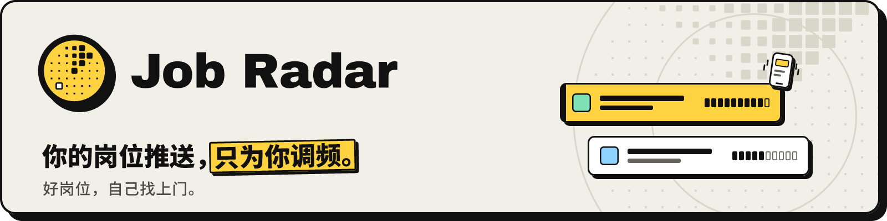

<p align="center">
  <picture>
    <source media="(prefers-color-scheme: dark)" srcset="docs/images/brand/readme-header-zh-dark.png">
    
  </picture>
</p>

<h3 align="center">说出你想要的。它读遍每个岗位，帮你打分，好的直接推到你手机上。</h3>

<p align="center">
  <a href="LICENSE"></a>
  <a href="https://github.com/Joevonlong/job-radar/releases"></a>
  <a href="https://github.com/Joevonlong/job-radar/actions/workflows/ci.yml"></a>
  
  
</p>

<p align="center">
  <a href="https://joevonlong.github.io/job-radar-site/zh/"><b>官网</b></a> ·
  <a href="docs/README.zh.md"><b>文档</b></a> ·
  <a href="#快速开始"><b>快速开始</b></a> ·
  <a href="docs/faq.zh.md"><b>常见问题</b></a> ·
  <a href="README.md"><b>English</b></a>
</p>

<p align="center">
  
</p>

<table>
  <tr>
    <td width="50%"><p align="center"><b>所有来源，汇成一条</b></p></td>
    <td width="50%"><p align="center"><b>你的规则说了算</b></p></td>
  </tr>
  <tr>
    <td width="50%"><p align="center"><b>每个岗位它都替你读</b></p></td>
    <td width="50%"><p align="center"><b>好的，直接送到你手上</b></p></td>
  </tr>
</table>

## 它做什么

- **采集**：从你挑的招聘网站、公司招聘页和职位提醒邮件拉新岗位，重复的合成一条。
- **过滤**：按你的城市、薪资底线、合同类型，以及你用自己的话写下的“绝不接受”。
- **打分**：用你自己的 AI（`claude` / `codex` 订阅或 API key）给每个岗位打 0–100 分，写明理由、差距和 JD 原文里的薪资。
- **推送**：好的推到你自己的 Telegram bot，点按钮就能在申请看板上推进。
- **回答你的 AI 客户端**（可选，默认关闭）：Claude Desktop、Claude Code 等 MCP 客户端可以经本机只读的 MCP 服务查询你的岗位和申请（[docs/mcp.zh.md](docs/mcp.zh.md)）。
- **始终是你的**：自托管、开源、不用注册、没有遥测。它不会替你投简历。

更多见[功能和截图](docs/features.zh.md)。

## 快速开始

需要：Docker（Compose 2.24 或更新）、Node 22 和 pnpm 11、git；macOS 或 Linux（Windows 在 WSL2 里跑，见
[平台说明](docs/installation.zh.md#macoslinuxwindows)）。

```bash
git clone https://github.com/Joevonlong/job-radar.git
cd job-radar
git checkout v2.0.1                  # 最新发布版；main 是开发分支
cp .env.example .env                 # 每个值都有能用的默认值；密钥以后填在这里
```

Linux 上，第一次启动前让容器以你的用户身份运行（macOS 不用）：

```bash
sed -i.bak -e "s/^PUID=.*/PUID=$(id -u)/" -e "s/^PGID=.*/PGID=$(id -g)/" .env && rm .env.bak
mkdir -p data/config data/profile data/backups data/exports data/logs .auth
```

先在这台机器上登录你的 AI（运行 `claude` 后输入 `/login`，或者 `codex login`）。然后启动服务和 AI worker（让它一直开着）：

```bash
docker compose up -d --build         # db、web、runner、jobspy；第一次构建要几分钟
pnpm install
pnpm ai-worker                       # 或用 scripts/ops/install-ai-worker.sh 装成后台服务
```

打开 <http://127.0.0.1:3000>。设置向导会问你 8 个小问题。向导完成之前，不会采集任何东西。

这台机器没有浏览器？那就在终端里跑同一个向导：

```bash
pnpm run setup                       # 全部 8 步
pnpm run setup --step telegram       # Telegram 推送，建好自己的 bot 之后
pnpm run doctor                      # 体检，并告诉你该怎么修
```

完整步骤（含升级、备份、手机访问、排错）见 **[docs/installation.zh.md](docs/installation.zh.md)**。

## 文档

- [功能和截图](docs/features.zh.md)：它做什么、怎么工作
- [安装](docs/installation.zh.md)和[首次设置](docs/setup.zh.md)
- [配置](docs/configuration.zh.md)：你的设置放在哪
- [AI 怎么接](docs/ai-providers.zh.md)：订阅命令行还是 API key，花多少钱
- [隐私](docs/privacy.zh.md)：存了什么，什么会离开你的机器
- [常见问题](docs/faq.zh.md) · [路线图](docs/roadmap.zh.md) · [全部指南](docs/README.zh.md)

## 参与贡献

欢迎提 issue 和 PR：见 [CONTRIBUTING.md](CONTRIBUTING.md)（英文）和 [docs/development.md](docs/development.md)。
每个 commit 都要带 DCO 签名（`git commit -s`）。提问请到 [Discussions](https://github.com/Joevonlong/job-radar/discussions)；
参与社区须遵守[行为准则](CODE_OF_CONDUCT.md)。

## 安全

请按 [SECURITY.md](SECURITY.md) 私下报告安全问题。看板只监听 `127.0.0.1`；别人能访问到它之前，先用 `pnpm web:password`
设一个口令（[网页访问](docs/configuration.zh.md#网页访问可选口令监听地址和端口)）。

## 抓取与网站条款

抓取网站的来源在新安装里是关闭的，打开前要你确认；遵守各网站的条款是你自己的责任。本项目与任何招聘网站无关联，商标归各自所有者。
详情和免责声明见 [docs/sources.zh.md](docs/sources.zh.md#抓取)、[NOTICE](NOTICE)。

## 许可证

[AGPL-3.0-only](LICENSE)。把修改过的版本作为服务提供给别人，就要向他们提供你的源代码；公司和团队见
[docs/commercial-use.zh.md](docs/commercial-use.zh.md)。基于 Next.js、PostgreSQL、Drizzle ORM 和 python-jobspy 构建。
