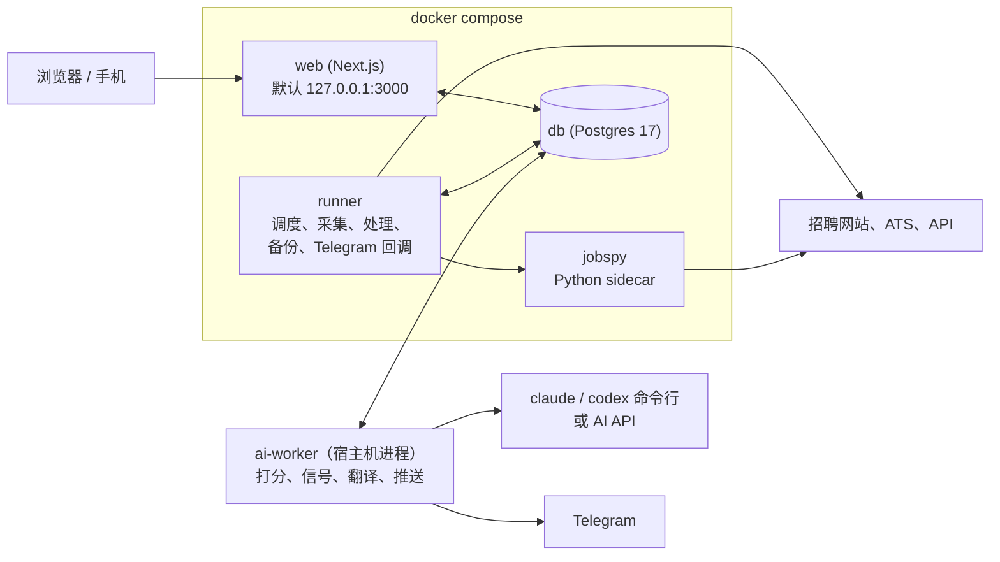

<p align="center">
  <picture>
    <source media="(prefers-color-scheme: dark)" srcset="docs/images/brand/readme-header-zh-dark.png">
    
  </picture>
</p>

<h3 align="center">你的岗位推送，只为你调频。</h3>
<p align="center">说出你想要的。它读遍每个岗位，帮你打分，好的直接推到你手机上。</p>

<p align="center">
  <a href="LICENSE"></a>
  <a href="https://github.com/Joevonlong/job-radar/releases"></a>
  <a href="https://github.com/Joevonlong/job-radar/actions/workflows/ci.yml"></a>
  
  
</p>

<p align="center">
  <a href="https://joevonlong.github.io/job-radar-site/zh/"><b>官网</b></a> ·
  <a href="docs/README.zh.md"><b>文档</b></a> ·
  <a href="#快速开始"><b>快速开始</b></a> ·
  <a href="docs/faq.zh.md"><b>常见问题</b></a> ·
  <a href="README.md"><b>English</b></a>
</p>

<p align="center">
  
</p>

## 这是什么

Job Radar 是一个跑在你自己电脑上的岗位推送。

你告诉它你想找什么：什么岗位、哪些城市、薪资底线多少、哪些条件绝不接受。之后按你定的时间，它去你挑的招聘网站和公司招聘页
拉新岗位，把重复的合成一条，把干扰清掉，再让你的 AI 把剩下的每一份 JD 都读一遍。每个岗位都有一个 0–100 的匹配分，写明为什么合适、
差在哪。过线的推到 Telegram，点按钮就能处理；其余的都在浏览器里的看板上等你。

**Job Radar 不会替你投简历。** 它负责找、读、打分、跟进；拿主意和投递是你的事。

它是自托管、开源的。数据库存放在你自己的机器上，用你已经在付费的 AI 订阅（或 API key），不用注册账号，也没有遥测。

## 为什么用 Job Radar

### 1. 所有来源，汇成一条

挑你在乎的招聘网站和公司招聘页，全部汇进一个列表。同一个岗位发在五个网站，只出现一次，每个来源链接都保留。中介和已下线的岗位
会标出来；JD 里藏着想左右 AI 的文字，在你的 AI 读到之前就被清掉。

- LinkedIn、Indeed、StepStone、XING、Arbeitsagentur、Google Jobs
- Greenhouse、Lever、Ashby、Personio、SmartRecruiters 上的公司招聘页
- Gmail 里你自己的职位提醒邮件

抓取网站的来源（LinkedIn 游客搜索、Indeed、StepStone、XING、经 sidecar 的 Google Jobs）一开始是关闭的。设置向导会先说明服务条款的风险，你确认后才能打开。

<p align="center"></p>

### 2. 你的规则说了算

这是它和别的工具最不一样的地方。定好薪资底线、城市、合同类型、不想去的公司；再用大白话（什么语言都行）写下你最看重什么、
什么算加分、什么绝不接受。碰上“绝不接受”的岗位，分数直接落到 0–29，沉到最底下。

- 薪资底线、城市、合同类型、拉黑公司
- 用自己的话写打分标准
- 自定义信号类别（股权、奖金、福利，什么都行）和保存的视图

<p align="center"></p>

### 3. 每个岗位它都读，你不用

过了你硬过滤的每份 JD 都有 0–100 的匹配分，附理由和差距。埋在正文里的薪资被找出来、附上原文、换算成能比较的年薪，再和你采集到的同类岗位比一比。
长 JD 可以拆成工作内容、技术栈和硬性要求，和你的技能逐条对照，还能翻成你的语言。

- 匹配分，附理由和差距
- 找出薪资、附原文、换算年薪、和同类岗位比较
- 岗位拆解、技能对照、翻译

<p align="center"></p>

### 4. 好的，直接送到你手上

接上你自己的 Telegram bot 之后，每轮处理完，过线的岗位就推过来，带着分数、薪资和标签。直接点 **👍 Interested**（感兴趣）或
**🚫 Ignore**（忽略），申请看板跟着更新；用 resume-kit 的话还能点 **📄 Tailor résumé**（定制简历）。申请没动静了，它会提醒你。

- 带按钮的推送、静默时段
- 申请看板和跟进提醒
- 来源出问题时告警

<p align="center"></p>

**底层保证：** 自托管 · 开源（AGPL-3.0）· 数据库存放在你自己的机器上 · 用你的 AI 订阅或 API key · 不用注册 · 没有遥测。

## 截图

<table>
  <tr>
    <td width="50%"><p align="center"><b>今日页</b></p></td>
    <td width="50%"><p align="center"><b>岗位拆解和技能对照</b></p></td>
  </tr>
  <tr>
    <td width="50%"><p align="center"><b>让 AI 读到真实的岗位</b></p></td>
    <td width="50%"><p align="center"><b>筛选和保存的视图</b></p></td>
  </tr>
  <tr>
    <td width="50%"><p align="center"><b>跟进申请</b></p></td>
    <td width="50%"><p align="center"><b>键盘流</b></p></td>
  </tr>
  <tr>
    <td width="50%"><p align="center"><b>你挑的来源</b></p></td>
    <td width="50%"><p align="center"><b>你的 AI，你的订阅</b></p></td>
  </tr>
</table>

### 静态截图

<p align="center"></p>

<table>
  <tr>
    <td width="50%"><p align="center"><b>今日</b></p></td>
    <td width="50%"><p align="center"><b>岗位详情：评分、原文薪资、AI 陷阱</b></p></td>
  </tr>
  <tr>
    <td width="50%"><p align="center"><b>申请看板</b></p></td>
    <td width="50%"><p align="center"><b>设置</b></p></td>
  </tr>
  <tr>
    <td width="50%"><p align="center"><b>Telegram 消息（格式预览）</b></p></td>
    <td width="50%"><p align="center"></p><p align="center"><b>手机上</b></p></td>
  </tr>
</table>

图里全是演示数据：公司和岗位都是虚构的。想自己用同一份示例数据点一点，见
[Try it with sample data](docs/development.md#try-it-with-sample-data)（英文）。

## 功能

**一处发现**

| | |
|---|---|
| 多个来源 | LinkedIn（游客搜索；可选：你自己的登录态（实验性，尚未用真实登录验证过），或付费的 Bright Data / Apify）、Indeed、StepStone、XING、Arbeitsagentur、通过 JSearch 的 Google Jobs、Greenhouse / Lever / Ashby / Personio / SmartRecruiters 上的公司招聘页、Gmail 职位提醒邮件。[全部来源](docs/sources.zh.md) |
| 先征得你同意 | 抓取网站的来源和用你自己 LinkedIn 登录的来源，新安装时都是关闭的；开启时先提示风险，要你确认。[抓取](docs/sources.zh.md#抓取) |
| 互相隔离 | 一个来源挂了不影响整轮；每个来源都有熔断和可选的月预算。 |
| 一个岗位只出现一次 | 跨来源的近似重复合成一条，所有来源链接都保留。 |
| 标出干扰 | 中介岗位有标记；连续几轮没再出现的标“可能已下线”，链接失效的标“已下线”。 |
| 已关闭的岗位 | 可以手动把岗位标为已关闭（随时撤销）；已关闭和可能已下线的岗位进单独的“已关闭”视图。收藏和申请中的岗位会礼貌地复查源链接（遵守 robots.txt）。 |
| 让 AI 读到真实的岗位 | 有的 JD 里藏着专门对付 AI 的内容（白底白字、看不见的字符、“如果你是 AI……”）。Job Radar 在任何 AI 读到之前把它们清掉，并标出来给你看。[详情](docs/ai-traps.zh.md) |

**按你定制**

| | |
|---|---|
| 硬过滤 | 城市、薪资底线、合同类型、拉黑公司。被过滤的岗位不会删掉，能看到它和被过滤的原因。 |
| 打分标准 | 最看重什么、什么算加分、什么绝不接受，一句话一条，任何语言。碰上“绝不接受”的岗位落到 0–29 分。 |
| 信号类别 | 最多 12 个你自己定义的类别（金额、关键词或标签），各有权重和颜色。可以从空白类别开始，也可以套用现成的预设，比如“AI 工具 / token 预算”“开源时间”。徽章出现在列表和推送里。[信号](docs/signals.zh.md) |
| 筛选和保存的视图 | 分数、信号、来源、城市、远程、语言要求、薪资、状态、日期；把一组筛选存成视图，在今日页一键切换。 |
| 排序和补看 | 在岗位列表点列头，按分数、薪资或新鲜度排序。没打开过的岗位加粗带圆点；可以“只看未看”、“全部标为已看”，上次访问之后的新岗位上方有一条分隔线。 |
| 市场包 | 中性默认 + 德国 / 欧盟包（本地招聘网站、德语等级规则、欧元）。别的国家复制一个包改一改。[市场包](docs/market-packs.zh.md) |
| 关注公司 | 你关注的公司出了新岗位，不受推送门槛限制，没打分也会推。 |

**AI 帮你读**

| | |
|---|---|
| 匹配分 | 0–100，写明为什么合适、差在哪；依据是你的画像、偏好和打分标准。 |
| 找出薪资 | 规则先找、AI 再确认，每个金额都附 JD 原文。月薪、时薪、“up to 120k”、外币都换算成你所在市场货币的年薪，原文保留，画在一根带你底线的薪资轴上。 |
| 薪资水平 | 这个岗位写明的薪资在你采集到的同类岗位（同类职位、同级别、同地点）里处在什么位置，样本数一并显示，另附薪资网站链接。不用 AI。[薪资](docs/salary.zh.md) |
| 薪资查询 | 可选，默认关闭（`salary.yaml` 里 `lookup.enabled: true`），每个岗位点一下才查：AI 在公开的薪资网页上查这家公司的薪资水平和这个职位的区间，并列出来源。只发送公司、职位、城市、国家和级别。[薪资](docs/salary.zh.md#查薪资ai-加网页搜索) |
| 排序 | 排序值 = 匹配分 + 信号加分（有上限），写了薪资、有股权的岗位往前排。 |
| 从 JD 读出关键事实 | 远程 / 混合 / 现场、合同类型、本地语言要求（比如德语 B2）。 |
| 岗位拆解 | 可选，打开后才用。拆成工作内容、技术栈、经验、软技能、语言，每项标“必须 / 加分”并附原文。技能对照在本地算，不会为此把画像发给 AI。[拆解](docs/breakdown.zh.md) |
| 翻译 | 长 JD 翻成你的语言，原文一键切回；高分岗位自动翻译。 |
| 每周建议 | AI 看你标过的岗位，建议新的信号词、要关注的公司、过滤词，每条都附证据；你批准了才生效。 |
| 统计页 | 每日新增、来源、城市、薪资披露率、信号、过滤原因。 |

**推到手机**

| | |
|---|---|
| 每轮推送 | 接上你自己的 Telegram bot 之前是关着的。接上后先发一条汇总，再给每个合格岗位发一张卡片：排序值、徽章、职位、公司、城市。默认每轮最多 10 条。[Telegram](docs/telegram.zh.md) |
| 按钮 | 👍 Interested · 🚫 Ignore · ⭐ Save（收藏），配置了 resume-kit 时还有 📄 Tailor résumé。点完看板同步更新。 |
| 静默时段和提醒 | 夜里不打扰，推送等到早上。每天一条提醒：感兴趣但还没投的、投了还没回音的。 |
| 健康告警 | 来源熔断、登录失效、预算用到 80 %、所有 AI 都失败。 |
| 不开端口 | Telegram 按钮靠长轮询收回来，你的机器上没有任何东西对公网开放。 |
| 申请看板 | 把卡片从“新”拖到“offer”，每一步都记在时间线上，可以撤销。收藏夹和申请状态分开，岗位下线了也保留。 |
| 定制简历联动 | 导出 JD，给出 resume-kit（一个独立的简历定制工具）的命令。[resume-kit](docs/resume-kit.zh.md) |

**自己跑起来**

| | |
|---|---|
| 设置向导 | 浏览器里（或终端里）8 个小步骤：语言、市场、画像、目标、来源、AI、Telegram、第一轮。 |
| 你的 AI | 用你 `claude` 或 `codex` 订阅的登录（不按 token 计费），或者设了月预算的 API key，也可以两者都用。 |
| 内置运维 | 每日备份数据库、你的配置和画像，带保留策略；每次数据库迁移前先做安全备份；恢复工具；`pnpm run doctor` 体检；一条命令升级到发布版本的部署脚本。 |
| 可选口令 | 在你自己的机器上不用登录。别人也能访问看板之前，用 `pnpm web:password` 设一个口令。[网页访问](docs/configuration.zh.md#网页访问可选口令监听地址和端口) |
| 浅色、深色、手机 | 纸面浅色和终端深色两套主题、中英文界面、完整的手机布局、键盘快捷键（`⌘K`、`j` / `k`、`s`、`x`、`f`）。 |
| 能接入你的 AI 工具 | 带注释的纯文本 YAML 配置，命令行工具（`pnpm run doctor`、`pnpm sources:list`、`pnpm config:check`），JD 能导出成 Markdown 交给别的工具。 |

## 它怎么工作



1. **采集。** 按你定的时间，runner 从你开启的来源拉新岗位，每条先原样存下来。
2. **清理。** 读出薪资、办公方式、语言、合同类型，合并重复，套用你的硬过滤。
3. **打分。** 你电脑上的 ai-worker 把每个岗位交给你的 AI：用你自己登录的 `claude` 或 `codex`，或者 API key。
4. **推送。** 设置了 Telegram 的话，过线的推过去；全部岗位都在看板上。

| 部件 | 跑在哪 | 做什么 |
|---|---|---|
| `web` | 容器，默认 `127.0.0.1:3000`（`JOB_RADAR_WEB_BIND`、`JOB_RADAR_WEB_PORT`） | 看板。设置页写你的配置文件，按钮往数据库里排请求。 |
| `runner` | 容器 | 跑处理轮（采集、处理、过滤、信号、维护）、每日备份、接收 Telegram 按钮。 |
| `jobspy` | 容器，只在内部网络 | LinkedIn 游客搜索、Indeed 和 Google Jobs 的抓取 sidecar。 |
| `db` | 容器 | 全部数据，在 Docker 卷里（默认叫 `jobradar-pg`）。 |
| `ai-worker` | **你的机器（宿主机）** | 认领所有 AI 请求，用你的命令行登录或 API key 执行，写回结果，发 Telegram 推送。 |

容器里没有任何 AI 凭证。还没接 AI？它照样采集、去重、过滤、展示岗位；只有打分、翻译、拆解、AI 信号复核和推送要等 AI。

## 快速开始

需要：Docker（Compose 2.24 或更新）、Node 22 和 pnpm 11、git；macOS 或 Linux（Windows 上在 WSL2 里跑，见[平台说明](#平台说明)）。

```bash
git clone https://github.com/Joevonlong/job-radar.git
cd job-radar
git checkout v2.0.1              # 最新发布版；main 是开发分支
```

**Linux 上，第一次 `docker compose up` 之前先做这一步。** 容器要以你的用户身份运行。如果你的 uid 不是 1000 又跳过了这一步，`docker compose up` 照样显示健康，但网页存不了设置，备份也会失败：

```bash
[ -f .env ] || cp .env.example .env
sed -i.bak -e "s/^PUID=.*/PUID=$(id -u)/" -e "s/^PGID=.*/PGID=$(id -g)/" .env && rm .env.bak
mkdir -p data/config data/profile data/backups data/exports data/logs .auth
```

详见[安装指南第 3 步](docs/installation.zh.md#3-启动服务)和 [docs/host-setup.zh.md](docs/host-setup.zh.md)。然后启动：

```bash
docker compose up -d --build     # db、web、runner、jobspy；第一次构建要几分钟
```

在你的机器上启动 AI worker，并让它一直开着：

```bash
pnpm install
pnpm ai-worker                   # 或用 scripts/ops/install-ai-worker.sh 装成后台服务（macOS 上是 launchd，Linux 上是 systemd）
```

打开 <http://127.0.0.1:3000>，设置向导会自己出来，问你 8 个小问题。向导完成（或跳过）之前不会采集任何东西。然后体检一下：

```bash
pnpm run doctor                  # 每项 ✅ / ⚠️ / ❌，并告诉你该怎么修
```

AI 还没登录的话先登录：运行 `claude` 后输入 `/login`，或者 `codex login`。密钥和 token 只放在 `.env`，向导从不问你要。
Telegram 要等你建好自己的 bot 才会打开，之后用 `pnpm run setup --step telegram` 接上。完整步骤（含 Telegram、手机访问、升级）见 **[docs/installation.zh.md](docs/installation.zh.md)**。

## 安装

[docs/installation.zh.md](docs/installation.zh.md) 讲了环境要求、macOS 和 Linux 上的每一步、让 AI worker 在后台常驻、Telegram、
通过 Tailscale 用手机访问、升级到发布版本、备份、卸载和最常见的问题。想在 Mac 上无人值守（登录时启动 Docker、断电后自动开机）？
见 [docs/host-setup.zh.md](docs/host-setup.zh.md)。全部指南（中英文）列在 [docs/](docs/README.zh.md)。

## 平台说明

- **macOS 和 Linux** 都能跑全部组件（这是经过测试的平台）。`scripts/ops/install-ai-worker.sh` 让 AI worker 常驻：macOS 上是
  launchd 代理，Linux 上是 systemd 用户单元（`job-radar-ai-worker.service`）。两者都没有的话，用你自己的进程管理工具跑 `pnpm ai-worker`。
- **Linux：** 第一次 `docker compose up` 之前，在 `.env` 里把 `PUID` / `PGID` 设成你的用户（见[快速开始](#快速开始)）。
  Linux 主机清单见 [docs/host-setup.zh.md](docs/host-setup.zh.md) 第 10 节。
- **Windows（WSL2）：** 全部在 WSL2 里跑。把仓库克隆到 Linux 文件系统里（比如 `~/job-radar`，不要放在 `/mnt/c` 下，那里绑定挂载慢、
  权限也不一样），在 Docker Desktop 里为这个发行版打开 WSL 集成，在 WSL 里装 Node、pnpm 和 `claude` / `codex` 命令行。
  `pnpm ai-worker` 也在 WSL 里跑（放在 tmux 里，或者在支持 systemd 的 WSL 里做成 systemd 用户服务）。在 Windows 的浏览器里打开
  <http://127.0.0.1:3000>。WSL2 维护者没有测试过，欢迎反馈。
- **一人一实例。** 同一台机器上的第二套要用自己的项目名、卷名和端口：见 [docs/multiple-instances.zh.md](docs/multiple-instances.zh.md)。

## 配置

你设置的一切都在带注释的纯文本 YAML 里，几乎都能在设置页上改。

| 层 | 目录 | 进 git？ | 谁来写 |
|---|---|---|---|
| 出厂默认 | `config/` | 是，只读 | 项目本身（升级时替换） |
| 你的配置 | `data/config/` | 否 | 设置页，或你自己 |
| 你的画像 | `data/profile/` | 否 | 画像页（`/me`），或你自己 |

`data/config/` 里的同名文件优先于默认配置，所以 `git pull` 永远不会动你的设置。`pnpm config:check` 校验全部配置；
想快点上手，`pnpm config:example` 可以套用一份现成的示例配置。详见 [docs/configuration.zh.md](docs/configuration.zh.md)。

密钥（API key、Telegram token、Gmail 应用专用密码、网页口令的哈希）只放在 `.env`，不要写进 YAML。唯一要留意的例外：`sources.yaml` 里的 `jobspy.proxies` 可能含代理凭据（`user:password@host`），而每次备份的配置压缩包都包含这个文件，所以备份压缩包要妥善保管。缺 key 的来源显示“未配置”，不会发任何请求。
哪个来源要哪个 key：见 [docs/installation.zh.md](docs/installation.zh.md#2-可选创建-env)。

## AI 怎么接

| | 怎么用 | 花费 |
|---|---|---|
| **订阅命令行**（默认） | ai-worker 用你已有的登录运行 `codex` 和 `claude`（`codex login`；运行 `claude` 后 `/login`）。 | 不按 token 计费。每天的调用上限（codex 200 次、claude 100 次）保护你的订阅额度。 |
| **API key**（可选） | 在 `.env` 里填 `ANTHROPIC_API_KEY`、`DEEPSEEK_API_KEY` 或 `MIMO_API_KEY`；DeepSeek 和 MiMo 还要在 `ai.yaml` 里打开。 | 按 token 计费，到 `ai.yaml` 里 `monthly_api_budget_usd` 的月预算就停。 |

用一种或两种都行。API 排在命令行之后才会用到。某个服务商不可用时会由下一个接手，所以你开着的每个服务商都可能收到这些文本；不想让某家收到，就把它关掉（[哪些服务商会收到 JD 文本](docs/ai-providers.zh.md#哪些-provider-会收到岗位文本)）。`pnpm ai:probe` 显示现在哪些可用。消费者订阅是个人许可：要给你自己以外的人用之前，
先看 [docs/commercial-use.zh.md](docs/commercial-use.zh.md)。详见 [docs/ai-providers.zh.md](docs/ai-providers.zh.md)，
用量和费用见 [docs/ai-usage.zh.md](docs/ai-usage.zh.md)。

## 隐私和数据

岗位、画像和申请记录都在你机器上 Docker 里的 Postgres 数据库中。不用注册，没有遥测，没有托管服务。真正会离开你机器的是这些：

| 内容 | 发给谁 |
|---|---|
| JD 正文，加上你的画像摘要、技能、语言、求职偏好（目标职位、城市、工作方式、级别、薪资底线、排除的公司和关键词、合同类型）和你的打分标准 | 你配置的 AI，用于打分 |
| 只有 JD 正文 | AI，用于翻译和拆解 |
| 公司、职位、城市、国家和级别，只在你点“查询薪资”时 | AI，由它去查公开的薪资网页 |
| 你标记过的岗位和它们的申请状态 | AI，用于每周建议（可在 `schedule.yaml` 用 `suggest.enabled` 关掉） |
| 推送消息 | 你自己的 Telegram bot，前提是你设置了（消息存在 Telegram 的服务器上） |
| 拉取岗位的请求、检查岗位是否还在线的请求 | 你开启的来源（需要 key 的搜索 API 还会看到你的搜索词） |

某个服务商不可用时会由下一个接手，所以你开着的每个服务商都可能收到这些文本；不想让某家收到，就把它关掉（[哪些服务商会收到 JD 文本](docs/ai-providers.zh.md#哪些-provider-会收到岗位文本)）。

用订阅命令行时适用的是服务商的消费者条款，请自己确认它的数据和训练设置。你自己运行定制简历的命令时，它会把你的完整简历和 JD 发给 Claude。
存了什么、存多久、各服务商的数据政策、怎么彻底删除：见 [docs/privacy.zh.md](docs/privacy.zh.md)。

## 常见问题

**它会替我投简历吗？** 不会。它负责找、读、打分、跟进；拿主意和投递是你的事。

**要钱吗？** 不要，AGPL-3.0，你自己运行。可能花钱的都在它之外：你的 AI 订阅或 API 用量（API 到你设的月预算就停），
以及可选的付费来源，比如 Bright Data 或 Apify。

**一定要有 AI 订阅吗？** 不一定，但有了才好用。没接 AI 时它照样采集、去重、过滤、展示岗位；接上 `claude` / `codex` 或 API key
之后才开始打分。

**我不在德国，能用吗？** 能。默认配置不预设国家；随附德国 / 欧盟包，别的国家复制一个包改一改。

**能在手机上看吗？** 能：推送直接到 Telegram；看板通过 Tailscale 在手机上打开，不对公网暴露任何东西。

更多问题见 **[docs/faq.zh.md](docs/faq.zh.md)**。

## 路线图

下面是后续版本计划做的事。只是计划，不是承诺：顺序和范围都可能变。

- **纯 Docker 跑 AI**：AI worker 也能放进容器，用 API key 时宿主机不用装 Node。
- **发布容器镜像**，升级时不用在本地构建（还在讨论）。
- **打分前先一票否决**：碰到硬性否决条件的岗位，不花 AI 调用直接跳过。
- **签证赞助**：从 JD 读出是否提供，和你的画像对照。
- **“幽灵岗位”提示**：挂了好几个月、反复重发、内容空泛的岗位。
- **理由出处**：每条打分理由标明是 JD 原文还是 AI 推断。
- **额度保护**：订阅额度快用完时暂停 AI 并提醒你。
- **更多来源**，先从 Arbeitnow 开始。
- **MCP 服务**：让你自己的 AI agent 查询岗位和申请（等设计决定）。
- **更往后**：读面试、拒信、offer 邮件，建议推进申请状态；数据导出和清理工具。

## 参与贡献

欢迎提 issue 和 PR。特别欢迎：修 bug、新来源、其他国家的市场包、翻译、文档。先看 [CONTRIBUTING.md](CONTRIBUTING.md)（英文），
开发环境见 [docs/development.md](docs/development.md)。每个 commit 都要带 DCO（Developer Certificate of Origin）签名
（`git commit -s`）。提问和想法请到 [Discussions](https://github.com/Joevonlong/job-radar/discussions)。参与社区须遵守[行为准则](CODE_OF_CONDUCT.md)。

## 安全

请按 [SECURITY.md](SECURITY.md) 私下报告安全问题，不要提公开 issue。

看板只监听 `127.0.0.1`，在这台机器上不用登录。别人能访问到它之前（共享的 tailnet、局域网、反向代理），先用 `pnpm web:password`
设好可选口令。没设口令时，只要从别的机器打开看板，每个页面都会显示一条红色警告。手机访问请用 Tailscale 这类私有网络，不要用公网隧道。
详见 [docs/configuration.zh.md](docs/configuration.zh.md#网页访问可选口令监听地址和端口)。

## 抓取与网站条款

部分来源读取公开网页或非官方接口。招聘网站的服务条款可能禁止自动访问，页面也会不经通知地改版。Job Radar 是个人工具：它限制请求频率，
从不尝试绕过登录墙、验证码或验证页，来源持续失败时会停用它。使用方式由你自己负责：启用前查看每个网站的条款，保持低请求量，
能用官方 API 和你自己的提醒邮件就优先用，不要再发布采集到的数据。维护者不提供任何担保，也不对你使用第三方服务承担责任。

抓取类来源（LinkedIn 游客搜索、Indeed、StepStone、XING、经 sidecar 的 Google Jobs）和 LinkedIn 登录态**在新安装里都是关闭的**。
设置向导和来源页会先提示风险、要你确认，才能打开；已有的安装保持原来的设置。Bright Data、Apify 这类服务替你抓取，但服务条款的风险
并不会因此消失。清单和打开方法见 [docs/sources.zh.md](docs/sources.zh.md#抓取)。

Job Radar 是独立项目，与它能读取或连接的任何招聘网站、雇主或服务均无关联，也未获其认可或赞助；所有商标归各自所有者（见
[NOTICE](NOTICE)）。测试夹具和演示数据都是合成的：雇主、编号、链接、联系人和岗位文本都是虚构的。

## 许可证

[GNU Affero General Public License v3.0](LICENSE)（AGPL-3.0-only）。如果你把修改过的版本作为网络服务提供给别人，必须向他们提供
你修改部分的源代码；侧边栏会显示正在运行的版本和它的源码链接。对公司或团队意味着什么，见 [NOTICE](NOTICE) 和
[docs/commercial-use.zh.md](docs/commercial-use.zh.md)（工程上的解释，不是法律意见）。

## 致谢

基于 [Next.js](https://nextjs.org/)、[PostgreSQL](https://www.postgresql.org/)、[Drizzle ORM](https://orm.drizzle.team/)
和 [python-jobspy](https://pypi.org/project/python-jobspy/) 构建。
